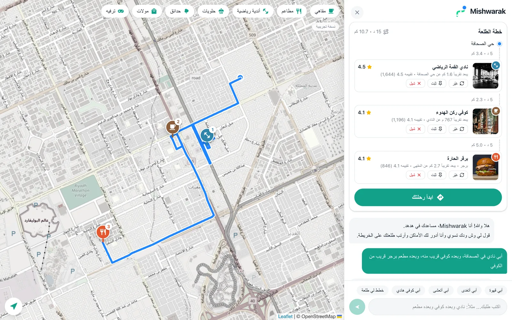
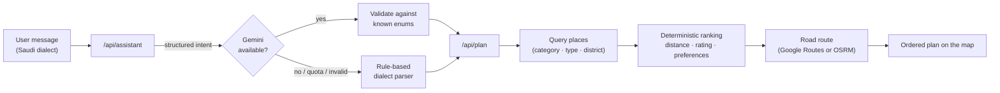

<p align="center">
  <picture>
    <source media="(prefers-color-scheme: dark)" srcset="public/branding/dallni-dark.png">
    
  </picture>
</p>

<h1 align="center">Dallni (دلّني)</h1>

<p align="center">
  <strong>An AI outing assistant concept for Hudhud Maps that understands Saudi dialect and plans multi-stop trips on the map.</strong>
</p>

<p align="center">
  
  
  
  
  
  <a href="LICENSE"></a>
</p>

<p align="center">
  <a href="https://hudhud-dallni.vercel.app"><strong>Try the live demo →</strong></a>
</p>

<p align="center">
  
</p>

---

## Overview

[Hudhud Maps](https://hudhud.sa/en) is a Saudi navigation app that is good at getting people to a destination. It is less helpful at deciding *where* to go. Its search works one keyword and one place at a time. To plan an evening with several stops (a gym, then a café nearby, then dinner), users search, compare, and search again for each stop.

**Dallni** ("guide me" in Saudi Arabic) is an assistant that sits inside the Hudhud map and closes that gap. A user writes one message in their own dialect:

> أبي نادي في الصحافة، وبعده كوفي قريب منه، وبعده مطعم برجر قريب من الكوفي
>
> *"A gym in Al Sahafa, then a café near it, then a burger place near the café."*

Dallni turns that message into an ordered plan on the map. Each stop is chosen near the previous one, with a short reason for the pick. The user can refine the plan in conversation, start an in-app trip, and afterwards publish an AI-drafted review, but only if they consent.

This repository contains the working prototype built for the *AI Feature Innovation Project*. The interface is in Arabic and right-to-left, as it would ship to Hudhud's users.

<picture>
  <source media="(prefers-color-scheme: dark)" srcset="docs/screenshots/plan-dark.webp">
  
</picture>

The [live demo](https://hudhud-dallni.vercel.app) runs without any API keys: it uses the offline demo dataset and the rule-based dialect parser, and it labels both in the interface.

> [!NOTE]
> Dallni is an independent student concept. It is **not** affiliated with, endorsed by, or connected to Hudhud. All place data in the demo database is synthetic.

## Features

| Feature | What it does |
|---|---|
| **Saudi-dialect understanding** | Turns requests like "a quiet café to study in Al Malqa" into structured filters (category, type, district, ranking priority). It asks one clarifying question only when a request is genuinely ambiguous. |
| **Multi-stop planning** | Plans up to six stops in the user's own order. Each stop is searched around the stop before it, so the outing stays compact. |
| **Conversational editing** | Understands edits such as "change the café", "a closer café", "make the restaurant Italian", "lock the gym", "add dessert after the gym", and "remove the restaurant", and rebuilds only what changed. |
| **Explainable picks** | Every stop shows its rating, its straight-line distance from the previous stop, and why it was chosen. Alternatives appear as secondary pins on the map. |
| **In-app trip** | Starts from the user's GPS position or a point they choose, follows a road route, shows basic Arabic turn guidance, and moves through the stops in order. |
| **Consent-based reviews** | After a visit, the user rates it. Gemini drafts a short review from the user's own words, and it is published only after the user explicitly agrees. |
| **Personalization with consent** | With a separate opt-in, Dallni remembers stated tastes (preferred cuisines, café types, districts, budget, things to avoid). Users can view or erase them from the settings sheet. |
| **Assistant feedback** | After an outing, Dallni asks once whether it helped (at most every 12 hours). An aggregate-only dashboard summarizes the answers. |
| **Light and dark themes** | Follows the device setting until the user picks a theme. The theme is applied before first paint, so there is no flash. |

## How it works

The core design rule: **the language model only interprets the request. It never chooses places.** Every recommendation comes from real database rows and a deterministic ranking that can be explained.



1. **Understand.** Gemini extracts a structured intent: the ordered steps, each step's category and subcategory, the district, the ranking priority, and any edit command. The server checks the response against the app's categories, subcategories, tags, and districts and drops anything invented. If Gemini is not configured, hits its quota, or returns something unusable, a rule-based Saudi-dialect parser answers instead.
2. **Retrieve.** Each step becomes an exact database query on category, optional subcategory, and optional district.
3. **Rank.** The planner scores candidates by proximity to the previous stop, rating, popularity, requested tags, and consented preferences. It prefers short hops (within 3, 6, then 12 km) when the data allows.
4. **Route.** The ordered stops are routed by road through Google Routes when a key is set, otherwise through OSRM on OpenStreetMap data. If routing fails, the map draws straight lines and says clearly that they are not driving distances.
5. **Learn, with consent.** Visit feedback and stated preferences are saved only after explicit opt-in, and only for that user.

### Graceful degradation

Every external service is optional. The app always tells the user which mode it is running in and never silently mixes data sources.

| Service | When configured | When not configured |
|---|---|---|
| **Supabase** | Places from the `hudhud_demo` schema. Reviews, visits, plans, and preferences stored per user under RLS. | A built-in offline demo dataset, labelled as demo. User data is kept in the browser. |
| **Google Gemini** | Intent extraction, conversational edits, feedback analysis, review drafting, preference extraction | Rule-based dialect parser and a review template |
| **Google Routes API** | Traffic-aware driving route and duration | OSRM road route (OpenStreetMap). No travel time is ever made up. |
| **Maps JavaScript API** | Google basemap | OpenStreetMap basemap via Leaflet |
| **Google Places API** | Live places, used only when Supabase is *not* configured | — |

## Tech stack

- **Framework:** Next.js 15 (App Router) with React 19 and TypeScript
- **Styling:** Tailwind CSS 4, design tokens as CSS variables, IBM Plex Sans Arabic
- **AI:** Google Gemini through the `@google/genai` SDK (server-side only)
- **Data:** Supabase (Postgres, row-level security, anonymous auth)
- **Maps and routing:** Leaflet with OpenStreetMap, or Google Maps; OSRM or the Google Routes API

## Getting started

### Prerequisites

- Node.js 22.12 or newer (the repository pins Node 24 in [`.nvmrc`](.nvmrc))
- npm

### Install and run

```bash
git clone https://github.com/Nadaalnashwan/HudhudDallni.git
cd HudhudDallni
npm install
cp .env.example .env.local   # optional: add keys (see Configuration)
npm run dev
```

Open <http://localhost:3000>. With no keys at all, the app runs fully in demo mode: offline sample places, the rule-based parser, and an OpenStreetMap basemap.

### Scripts

| Command | Description |
|---|---|
| `npm run dev` | Start the development server |
| `npm run build` | Create a production build |
| `npm run start` | Serve the production build |
| `npm run lint` | Run ESLint |
| `npm run typecheck` | Type-check the project with `tsc` |
| `npm test` | Run the unit tests (Vitest) |

### Tests

The unit tests cover the two parts of the app that decide what the user sees: the rule-based dialect parser ([`intent.test.ts`](src/lib/intent.test.ts)) and the stop planner ([`planner.test.ts`](src/lib/server/planner.test.ts)). They always run against the offline demo dataset, so they need no keys or network access. [GitHub Actions](.github/workflows/ci.yml) runs lint, typecheck, tests, and a production build on every push and pull request.

## Configuration

All variables are optional and go in `.env.local`, which git ignores. [`.env.example`](.env.example) lists every variable with comments.

| Variable | Scope | Purpose |
|---|---|---|
| `NEXT_PUBLIC_SUPABASE_URL` | Browser and server | Supabase project URL |
| `NEXT_PUBLIC_SUPABASE_PUBLISHABLE_KEY` | Browser and server | Supabase publishable key. **Never** use a `service_role` / secret key. |
| `GEMINI_API_KEY_1` … `_3` | Server | Gemini API keys. Extra keys are used only for failover during outages. |
| `GEMINI_MODEL` | Server | Gemini model ID (default `gemini-3.5-flash`) |
| `GOOGLE_MAPS_API_KEY` | Server | Places API (New) and Routes API |
| `NEXT_PUBLIC_GOOGLE_MAPS_BROWSER_KEY` | Browser | Maps JavaScript API. Restrict it by HTTP referrer. |
| `NEXT_PUBLIC_GOOGLE_MAP_ID` | Browser | Optional Google Map ID for map styling |
| `OSRM_URL` | Server | OSRM server (default: the public demo server, `router.project-osrm.org`) |

**Gemini failover policy.** Transient failures (5xx, timeouts, network errors) are retried with the next key, up to three attempts within 20 seconds. Invalid keys are skipped for the rest of the process. A quota error (429) pauses Gemini for the retry delay Google returns, and the rule-based parser takes over. Keys are never rotated to get around a quota.

## Deployment

The app is a standard Next.js project and deploys to [Vercel](https://vercel.com) without extra configuration. Add any variables from the table above in the project's environment settings. Keep Gemini and `GOOGLE_MAPS_API_KEY` as server-side variables. Anything you leave unset falls back to demo mode, which is how the [live demo](https://hudhud-dallni.vercel.app) runs.

For real traffic, point `OSRM_URL` at your own OSRM server or configure the Google Routes API, because the public OSRM demo server is not meant for production use.

## Database

The app reads and writes the `hudhud_demo` schema of a Supabase project. The seed holds 420 synthetic places: 21 subcategories × 10 Riyadh districts × 2. Every private table is owned by `auth.uid()` and protected by row-level security. The browser only ever holds the publishable key.

Setup steps, the access model, and validation queries are in [`supabase/README.md`](supabase/README.md).

## API reference

All routes are internal to the app and are called by the client components.

| Route | Method | Purpose |
|---|---|---|
| `/api/assistant` | `POST` | Interpret a chat message into a plan, clarifying question, edit, or chat reply |
| `/api/plan` | `POST` | Build or rebuild the ordered stops and the route through them |
| `/api/route` | `POST` | Road route between points, with optional Arabic turn guidance |
| `/api/place/[id]` | `GET` | Details for one place |
| `/api/review-draft` | `POST` | Draft a review from the user's rating, reasons, and note |
| `/api/feedback-analyze` | `POST` | Map a free-text visit note to known reasons and preference hints |
| `/api/config` | `GET` | Which data and AI sources are active, including a live database check. Key values are never returned. |
| `/api/photo` | `GET` | Proxy for Google Places photos, so the server key never reaches the browser |

## Project structure

```text
src/
├── app/
│   ├── api/                    Route handlers (see API reference)
│   ├── globals.css             Design tokens, light/dark themes, map styling
│   ├── layout.tsx              Root layout, Arabic font, pre-paint theme script
│   └── page.tsx                Entry page
├── components/
│   ├── HudhudApp.tsx           App shell: state, map, category filters, sheets
│   ├── AssistantChat.tsx       Chat thread and recommendation cards
│   ├── PlanPipeline.tsx        Ordered outing plan with edit controls
│   ├── PlaceCard.tsx           Place summary card
│   ├── PlaceSheet.tsx          Place details and published reviews
│   ├── TripNavigator.tsx       In-app trip: origin, routing, guidance
│   ├── FeedbackFlow.tsx        Post-visit rating, review draft, consent
│   ├── DallniFeedback.tsx      Feedback about the assistant and the stats sheet
│   ├── DallniLogo.tsx          Theme-aware logo
│   ├── ThemeToggle.tsx         Light/dark switch
│   ├── icons.tsx, ui.tsx       Shared presentational components
│   └── map/                    MapView, Leaflet and Google Maps implementations
└── lib/
    ├── catalog.ts              Category, subcategory, tag, and district taxonomy
    ├── intent.ts               Rule-based Saudi-dialect parser (tested in intent.test.ts)
    ├── store.ts                Anonymous auth, preferences, plans, visits, reviews
    ├── supabase.ts             Supabase client configuration
    ├── feedback.ts             Feedback reasons and preference merging
    ├── demoPlaces.ts           Offline demo dataset
    ├── geo.ts                  Distance, formatting, polyline decoding
    ├── types.ts                Shared domain types
    └── server/                 Server-only modules
        ├── gemini.ts           Gemini client with key failover and quota handling
        ├── planner.ts          Deterministic stop selection and ranking (tested in planner.test.ts)
        ├── places.ts           Place source selection (Supabase, Google, demo)
        ├── supabasePlaces.ts   Place queries against hudhud_demo
        └── routes.ts           Google Routes and OSRM routing
supabase/
├── README.md                   Database setup and access model
└── migrations/                 SQL applied on top of the seed
public/
├── branding/                   Dallni logo, light and dark variants
└── images/places/              Illustrative photos per place type (see CREDITS.md)
docs/screenshots/               README images
```

## Privacy and safety

- **No service-role key.** The browser uses only the publishable key, and row-level security enforces every access rule.
- **Anonymous by default.** Each browser gets an anonymous Supabase session. No names, emails, or phone numbers are collected.
- **Consent first.** Reviews are published only after an explicit yes. Preferences are saved only with a separate opt-in and can be erased at any time.
- **Aggregates only.** The assistant-feedback dashboard reads counts from a database function and never reads individual responses.
- **Honest data.** Synthetic places and illustrative photos are labelled as such. Distances are labelled as straight-line where that is what they are, and travel times appear only when a routing service returns them.
- **Server-side secrets.** Gemini and Google server keys never reach the browser. Place photos are proxied.

## Supported place types

| Category | Subcategories |
|---|---|
| Restaurants | Italian, fast food, burger, pizza, Saudi, shawarma, Indian, Asian, seafood, grill |
| Cafés | Specialty coffee, quiet, study-friendly, drive-through |
| Gyms | Fitness, women-only |
| Desserts | Bakery, ice cream |
| Parks · Malls · Entertainment | Public park · Shopping · Games |

The Arabic labels and the dialect synonyms the parser recognizes live in [`src/lib/catalog.ts`](src/lib/catalog.ts).

## Team

Built during a Tuwaiq Academy bootcamp as part of the *AI Feature Innovation Project*:

- Abdulaziz Alkhlaiwe
- Nada Alnashwan
- Abdulrhman Albakr
- Mohammed Almousa
- Bayan Alkathiri

## Acknowledgments

- Map data © [OpenStreetMap](https://www.openstreetmap.org/copyright) contributors. Road routing by [OSRM](https://project-osrm.org/).
- Illustrative place photos from [Unsplash](https://unsplash.com); sources are listed in [`public/images/places/CREDITS.md`](public/images/places/CREDITS.md).
- "Hudhud" and the Hudhud Maps name belong to their respective owner and are used here only to describe the concept.

## License

The source code is released under the [MIT License](LICENSE).

The license covers the code only. The Dallni logo in [`public/branding/`](public/branding) belongs to the team and is not licensed for reuse. "Hudhud" is a trademark of its owner. The place photos remain under the [Unsplash License](https://unsplash.com/license).
